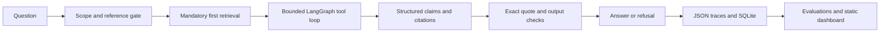

# RBI and SEBI Circular Research Agent

A local LangGraph agent that retrieves circular passages, uses bounded tools, and returns source-checked answers or explicit refusals. Includes evaluation, red-team experiments, traces, Colab notebooks, and a static results dashboard.

[Live dashboard](https://surya-8143.github.io/rbi-sebi-agent/) · [GitHub repository](https://github.com/surya-8143/rbi-sebi-agent) · [CI runs](https://github.com/surya-8143/rbi-sebi-agent/actions)

[](https://colab.research.google.com/github/surya-8143/rbi-sebi-agent/blob/14c82024743dce7e7ec605040a43f94c3ba743fe/notebooks/20_demo.ipynb)

The notebook is available; execution in an actual Colab runtime remains unverified. Upload the project ZIP produced by `python -m scripts.package` when its setup cell asks for source.

**Status:** implemented software with a fictional demonstration corpus. This is not yet a validated RBI/SEBI benchmark. No official PDFs or human-verified question labels were supplied. `evals/questions.jsonl` and the official manifest are deliberately empty. See [delivery status](docs/status.md) for what has and has not been run.

Open [the dashboard](docs/index.html) locally. It reads committed measurements, labels fictional runs, shows 95% intervals, and does not invent missing results.

Verified locally: **52 software tests passed**; a separate extracted source archive also passed all 52. On 20 fictional retrieval questions, BM25 recall@5 was 19/20 and dense/fusion/reranked retrieval each reached 20/20. A three-case Qwen3 4B CPU smoke test produced one correct cited answer and two correct refusals; the answer took about 238 seconds. The earlier timed-out run is retained. These tiny synthetic experiments are not official benchmarks.

## Quick start

Prerequisites: Python 3.11 (tested), Git, and Ollama for model answers. Python 3.11–3.13 is supported by the project metadata. Run from the repository root.

```powershell
python scripts/bootstrap.py
ollama pull qwen3:4b
.venv/Scripts/python.exe -m src.cli --fixture "What is the KYC record retention period in the FRA fictional KYC Records circular?"
```

On macOS/Linux use `.venv/bin/python`. The bootstrap creates a virtual environment, installs pinned direct dependencies, builds the fixture indexes, runs tests, measures BM25 retrieval, and builds the dashboard. It does not download an LLM. `python scripts/bootstrap.py --full` adds embeddings and FAISS. For full reranking, use the retrieval evaluator's `--rerank` option. Model downloads require internet and disk space; CPU model responses may take minutes.

`FRA` is the **Fictional Regulatory Authority**, not an actual regulator. The bundled corpus has 10 documents and 23 questions (20 answerable, 3 refusals). These are deterministic software fixtures, not the 120-question official evaluation.

PowerShell model configuration:

```powershell
$env:LLM_MODEL = 'qwen3:4b'
$env:LLM_TIMEOUT = '180'
```

The default endpoint is local Ollama at `http://127.0.0.1:11434/v1`. No paid API, tunnel, hosted inference, or API key is required. `.env.example` documents settings; `.env` is not automatically loaded.

## How it works



The four tools are `search_circulars`, `get_section`, `list_documents`, and `calculate`. Search combines BM25 and optional BGE embeddings using reciprocal rank fusion. An optional BGE cross-encoder reranks candidates. Sparse-only mode runs without model downloads and is labeled as such. The agent explicitly uses the plan's retrieve-first fallback: it always performs one initial search before asking the LLM for more tools. It permits at most five agent rounds and twelve actual tool executions, then up to two structured-answer attempts.

Every claim needs a retrieved chunk ID and an exact quote of at most 12 words. Whitespace normalization is allowed; fuzzy quote matching is not. The verifier uses only the text actually delivered to that request, after quarantine. **This is evidence integrity, not semantic entailment.** A model can still attach a real quote to a wrong claim. The evaluation measures supporting gold evidence separately.

## Add an official corpus

1. Obtain text PDFs from RBI and SEBI's official websites. Review their reuse policies before redistributing source material. Keep files in `data/raw/`; PDFs and extracted text are ignored by Git.
2. Add one row per PDF to `data/manifest.csv`: stable `doc_id`, issuer, title, ISO issue date, official HTTPS source URL, filename, optional circular reference and amendment relationship. Leave `sha256` and `pages` empty on the first import.
3. Run the following. Ingestion validates paths, dates, issuer, URL host, existing hashes, and extracted text. It fills hashes/page counts and writes a data report.

```powershell
.venv/Scripts/python.exe -m scripts.ingest
.venv/Scripts/python.exe -m src.retrieval.index --chunks data/processed/chunks.jsonl --dense
.venv/Scripts/python.exe -m src.cli "Your question about a loaded circular"
```

Building the official index replaces the local fixture index; omit `--fixture` for official questions. Do not merge fictional evidence into the ordinary official corpus. For an isolated attack index, combine official chunks with `redteam/poisoned_docs/chunks.jsonl` and build it under `index_attack/`. Scanned PDFs need OCR and are rejected. Tables are retained as extracted text but need manual inspection. Automatic supersession resolution is not implemented; source dates alone do not establish legal applicability.

## Evaluation

Author and verify the 120 questions in `evals/questions.jsonl` against the PDFs: 50 dev, 70 test, seven categories. The full schema and exact split counts are enforced by `evals.schema.validate_questions(..., full=True)`. Gold evidence uses document, page, and a short exact passage so it survives re-chunking. The schema includes `label_status`; official evaluation rejects unverified labels.

```powershell
.venv/Scripts/python.exe -m evals.retrieval_eval --out results/retrieval.json --rerank
.venv/Scripts/python.exe -m scripts.validate_dataset
.venv/Scripts/python.exe -m evals.calibrate
.venv/Scripts/python.exe -m evals.run --split dev --out results/baseline_dev.json --defense 0
.venv/Scripts/python.exe -m evals.run --split test --out results/baseline_test.json --defense 0
.venv/Scripts/python.exe -m evals.run --split test --out results/latest_test.json --defense 5
.venv/Scripts/python.exe -m scripts.check_results
```

For a fictional model run, use `--questions tests/fixtures/questions.jsonl --fixture --split dev` and a distinct output name. Set `RETRIEVAL_TAU` only after dev calibration with exactly the same retrieval configuration. Scores from BM25 fusion and a cross-encoder are not interchangeable. Without calibration the threshold is unset, not a claimed calibrated refusal policy.

The runner checkpoints each question with an fsync, repairs a torn final JSONL line on resume, and refuses to resume if the corpus, question set, prompt, model configuration, or Git SHA changes. Choose a new output file for a different experiment. Raw traces live in ignored `runs/` and a SQLite database. Operational failures are recorded as errors, never successful refusals. See [evaluation protocol](docs/eval_protocol.md).

## Red-team experiments

The catalog contains 40 attacks in six groups and five poisoned fictional documents. Baseline D0 retains essential calculator and input validation; we do not weaken the baseline to inflate improvement. D1 hardens prompts, D2 is the already-enforced validation baseline, D3 quarantines obvious instruction text, D4 checks leaks/verdicts, and D5 rejects unknown explicit references. Regex filters are not a security boundary. Retrieval inference has no hard cancellable subprocess timeout; local model calls have a request timeout.

```powershell
.venv/Scripts/python.exe -m redteam.run --fixture --defense 0 --out results/redteam_fixture_d0.json
.venv/Scripts/python.exe -m redteam.run --fixture --defense 5 --out results/redteam_fixture_d5.json
.venv/Scripts/python.exe -m scripts.build_dashboard
```

Run each intermediate defense level for a full ablation and repeat benign dev questions at D0 and D5. Review advice/verdict cases manually. An error is excluded from the success denominator and remains prominently reported. The report contains no security claim before these experiments exist. See [threat model](docs/redteam_report.md).

## Reproducibility and publication

`notebooks/00_colab_setup.ipynb`, `10_run_eval.ipynb`, and `20_demo.ipynb` run Ollama and the agent in the same notebook runtime. They accept an uploaded source ZIP, so no public repository is required to try them. No tunnels or web UI are created. GPU availability and notebook Python versions vary; inspect the runtime before running. Colab execution has to be verified in an actual user runtime.

GitHub Actions runs lint, meaningful offline tests, retrieval validation, and a recorded-results gate. Until official baseline/final files exist, CI prints **NOT RUN** for that gate. It does not imply a passed official benchmark. Once both files exist, the gate recomputes metrics from rows and checks identical question IDs and source fingerprints, operational errors, regression, and increased false refusal. It still trusts committed result rows; it cannot rerun the LLM on a GPU.

To publish after creating a GitHub repository, push the source, then enable Pages from the default branch / `docs`. Update the README with the actual repository URL, a Colab badge, measured results, and your recorded walkthrough. Publication status is tracked in docs/status.md.

Original code and fictional fixtures are MIT licensed. Third-party packages retain their licenses; PyMuPDF has separate licensing terms. RBI and SEBI are the intended official sources, not sponsors of this project. This tool provides research assistance, not legal, financial, tax, or investment advice.
